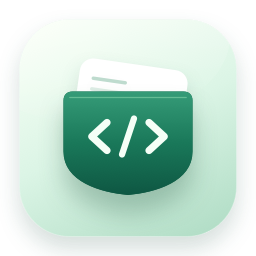

<p align="center">
  
</p>

<h1 align="center">DevPocket</h1>
<p align="center">开发者的随身工具箱，一个小工具，少一点打断。</p>

<p align="center">
  
  
  <a href="https://github.com/tianguzhe/DevPocket/actions/workflows/release.yml"></a>
</p>

<p align="center">
  <a href="https://github.com/tianguzhe/DevPocket/releases">下载发布版</a> ·
  <a href="https://github.com/tianguzhe/DevPocket/actions/workflows/release.yml">获取构建包</a>
</p>

原生 SwiftUI 应用，支持 **macOS 14+**，同时包含 **Apple Silicon / Intel** 架构。所有转换都在本机完成。

## 安装

需要 **macOS 14 或更新版本**，同一个安装包支持 Apple Silicon 和 Intel。

1. 从 [Releases](https://github.com/tianguzhe/DevPocket/releases) 下载 `DevPocket.dmg`。
2. 打开 DMG，将 DevPocket 拖入 Applications。
3. 从「应用程序」打开 DevPocket。

尚未发布版本时，可在 [GitHub Actions](https://github.com/tianguzhe/DevPocket/actions/workflows/release.yml) 打开最近一次成功的构建，在 Artifacts 下载 `DevPocket-<版本>-universal`，解压后获取 DMG。下载 Actions artifact 需要登录 GitHub。

安装包采用 ad-hoc 签名，尚未进行 Apple 公证。首次打开如被 macOS 拦截，可在「系统设置 → 隐私与安全性」中允许打开。

## 功能

| 工具 | 功能 |
| --- | --- |
| JSON | 格式化、压缩、键名排序、标量支持、语法高亮与错误提示 |
| 时间戳 | 秒 / 毫秒 / ISO 8601 / 本地日期互转，支持负数、小数和显示时区 |
| URL | RFC 3986 组件编码与百分号解码，保留字面的 `+` |
| Base64 | UTF-8 文本编解码，解码时允许空白与换行 |
| AES | CBC / PKCS7 加解密，Hex / Base64 密文、渠道密钥派生、JSON 结果预览 |
| 二维码 | 文本 / 网址自动生成、二维码预览、复制图片，支持尺寸和纠错等级选择 |

所有工具首次打开时输入与结果均为空白，直接粘贴或输入内容即可使用。时间戳页面提供「当前时间」，按所选的秒、毫秒或日期模式实时取时并转换。工具之间保留各自的输入与结果。修改输入后，旧结果会显示「待处理」，处理完成才能复制。原生文本编辑器支持撤销、选择和常用编辑快捷键。

薄荷色工作台采用统一的 SF Symbols 图标底座、紧凑的参数卡片和并排编辑区，使用「代码口袋」应用图标与侧栏标识。界面跟随系统深浅色，提供轻量的工具切换、悬停与复制反馈动画，并尊重「减少动态效果」设置。也可在「View → 外观」菜单中单独选择浅色或深色。

## 快捷键

| 快捷键 | 操作 |
| --- | --- |
| `⌘1`–`⌘6` | 切换工具（`⌘6` 打开二维码生成） |
| `⌘K` | 搜索工具，回车选择 |
| `⌘↩` | 处理当前内容 |
| `⌘⇧C` | 复制结果 |
| `⌘⇧V` | 从剪贴板粘贴到输入 |

URL、Base64 与 AES 页面支持将结果作为输入，执行反向转换。

二维码页面支持中文、emoji、多行文本和网址，保留输入原文；停止输入 1 秒后自动生成，修改尺寸或纠错等级也会自动更新，也可点击「生成二维码」立即生成。生成后可直接扫描或复制图片。图片尺寸可选 256 / 512 / 1024 像素，默认 512；纠错等级可选 L / M / Q / H，默认 M。图片采用黑码白底并保留扫码留白，所有处理均在本机完成。等待更新期间旧图片不可复制，清空输入会清除预览。

## AES 工作台

顶部横向配置密钥来源、密钥或名称、IV 和密文格式，下方并排编辑输入与查看结果。使用 `⌘5` 打开，输入与结果默认留空。

- **Package**：输入包名，直接保留其大小写，不足 16 位补 `0`，超出截取。例如 `Com.Example.App` → `Com.Example.App0`，不会执行渠道的 Base64 转换。
- **Channel**：输入渠道名，转小写后按 JavaScript `btoa` 的 Latin-1 规则做 Base64，再补 `0` 或截取前 16 位。例如 `Com.Example.App` → `Y29tLmV4YW1wbGUu`。中文和 emoji 会给出明确错误。
- **Other**：默认填入 `2CiuxU76w89E1OlZ`，可直接修改为 16 / 24 / 32 字节 UTF-8 密钥，对应 AES-128 / 192 / 256。每次在来源列表点击 Other，都会恢复默认密钥，包括已选中 Other 时再次点击；IV 和密文格式保持当前设置。默认 IV 为 `5873087691895047`。
- 包名与渠道名分别保留。自定义密钥在 Other 中直接编辑。
- 上述场景依据参考项目的直接解密、默认密钥和“计算渠道”操作区分。包名的补齐规则在加解密时保持一致；原工具只在解密时补齐，兼容其加密结果时应使用完整的 16 字节密钥。
- 密文支持 Hex 与 Base64，两种格式都允许空白与换行；Hex 不带 `0x` 前缀，输出为原始密文，不包含 OpenSSL `Salted__` 封装。
- 解密得到 JSON 时可格式化并高亮显示；复制与反向转换始终使用未经格式化的原始结果。

底层使用系统 CommonCrypto。CBC / PKCS7 不提供完整性认证，错误密钥或 IV 也可能产生可读结果；成功输出不代表密文已经通过真实性验证。默认 IV 用于兼容已有数据，本工具不提供自动密钥协商或 IV 封装。

## 构建

需要完整 Xcode。工程已生成，可直接打开 `DevPocket.xcodeproj`。

```bash
bash Scripts/test.sh
bash Scripts/build.sh
open build/DevPocket.app
```

`build.sh` 自动更新图标、构建 `arm64 + x86_64`、进行 ad-hoc 签名并验证架构和签名。输出为 `build/DevPocket.app`，完整日志保存在 `build/build.log`。

生成 DMG：

```bash
bash Scripts/package.sh
# 应用已构建时：
bash Scripts/package.sh --skip-build
```

安装包与 SHA-256 位于 `dist/`。产物采用 ad-hoc 签名，未经 Developer ID 签名或 Apple 公证。

DMG 使用薄荷色品牌背景、固定的双图标布局和中文拖拽指引，支持 Retina 显示。打包脚本会在 `build/dmg-tools` 创建独立的 Python 环境，首次运行需联网安装固定版本的 `dmgbuild` 及其依赖（Python 3.9+，可使用 Xcode 自带版本）；后续打包复用该环境。窗口布局直接写入安装包，无需启动 Finder，CI 与本地采用相同设置。背景预览位于 `build/dmg-background@2x.png`。

`project.yml` 是 XcodeGen 工程配置。修改目标或构建设置后，可运行 `xcodegen generate` 重新生成工程；日常构建不需要安装 XcodeGen。通过 `DEVPOCKET_DERIVED_DATA` 可指定 Xcode 缓存位置。

## 自动打包与发布

GitHub Actions 使用与本地相同的脚本，依次运行测试、构建双架构应用、生成 DMG，并验证应用签名、架构、安装包内容及 SHA-256。构建不需要配置 Apple 证书或额外 Secrets。

| 触发方式 | 结果 |
| --- | --- |
| 推送到 `main`、Pull Request、手动 Run workflow | 上传 DMG 和校验文件到 Actions Artifacts，保留 14 天 |
| 推送 `v*` 标签，例如 `v0.1.0` | 完成同样的验证后，自动创建 GitHub Release 并附上 DMG 和校验文件 |

发布前更新 `project.yml` 中的 `MARKETING_VERSION` 和 `CURRENT_PROJECT_VERSION`，执行 `xcodegen generate` 并提交生成的工程。标签必须与应用版本完全一致，否则工作流会拒绝发布。当前工程版本为 `0.1.0`，首次发布可执行：

```bash
git push origin main
git tag v0.1.0
git push origin v0.1.0
```

也可在发布前运行 `bash Scripts/app-version.sh` 确认实际构建版本。普通代码推送只生成 Actions 构建包，**推送版本标签才会发布到 Releases**。失败日志会保存为 `build-logs-...` artifact，保留 7 天。

## 数据与边界

- 单次输入最多 5 MB；大型 JSON 文档使用普通文本显示以保持编辑流畅。
- 二维码容量按 UTF-8 字节计算，L / M / Q / H 分别最多 2953 / 2331 / 1663 / 1273 字节；中文和 emoji 通常占多个字节。
- Base64 解码面向 UTF-8 文本，不用于导出二进制文件。
- 时间显示范围为公元 0001–9999 年；秒和毫秒由所选模式明确区分。
- 日期格式为 ISO 8601 或 `yyyy-MM-dd HH:mm:ss`，无时区日期按所选时区解释。
- 编辑状态保留在当前进程内，关闭应用后不会写入历史记录。

## 项目结构

```text
DevPocket/ToolEngine.swift       独立转换逻辑
DevPocket/AESEngine.swift        原生 AES 与 cy-tools 兼容规则
DevPocket/QRCodeEngine.swift     本地二维码生成、像素对齐与 PNG 编码
DevPocket/QRCodeView.swift       二维码配置与图片预览
DevPocket/AESConfigurationView.swift  AES 参数卡片
DevPocket/WorkspaceStore.swift   工具状态、后台处理与复制反馈
DevPocket/ContentView.swift      SwiftUI 界面与动效
DevPocket/PocketControls.swift   统一卡片、输入框、分段控件与按钮
DevPocket/CodeEditor.swift       原生文本编辑器与 JSON 高亮
Scripts/                        图标、测试、构建与打包
Tests/                          AES 跨实现样本、编码、时间边界及工作区状态测试
project.yml                     XcodeGen 工程配置
```
